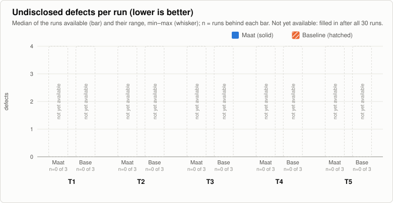
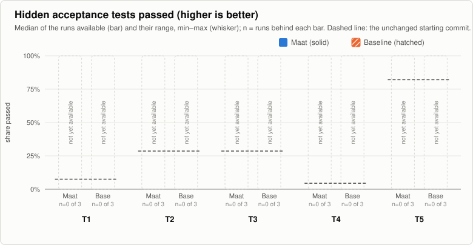
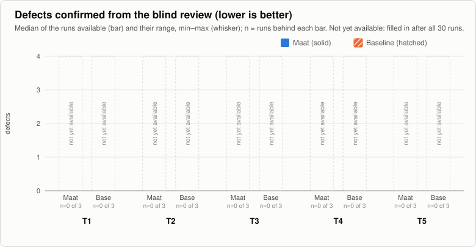
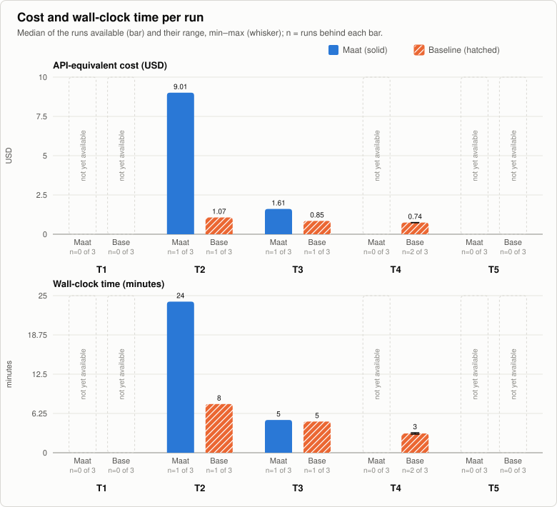

# Maat benchmark — pre-registration

**Status: prepared, not frozen, no run made.** This folder applies [`../BENCHMARK-PROTOCOL.md`](../BENCHMARK-PROTOCOL.md)
(version 2) to five tasks. It is published before the first run. The commit that freezes it changes only this
status line; its full commit id is the seed of the schedule (Procedure, step 1), and the first run starts only after
that commit is public. After it, nothing here changes except the «Results» section, which is filled in as the runs
go: a flaw found later restarts the benchmark under a new version of the protocol, as the protocol says.

## What is compared

- **Maat side:** Maat **1.6.0** (release tag `v1.6.0`, commit `f079090`), installed in the copy with the two
  commands of the main README (`claude plugin marketplace add https://github.com/Diegoiorio/maat.git#v1.6.0 --scope
  project`, then `claude plugin install maat@maat --scope project`), with the task's frozen `.claude/maat.json` (in
  `tasks/<task>/`, in place of an interactive `/maat:setup`). The full cycle is started by its deterministic driver,
  the same command that `/maat:full-implementation-cycle` launches: `driver.py run .claude/.ai-workflow/<spec> --`,
  with no flag (since 1.6.0 the driver is Maat's only engine; `FIC_DRIVER` has no effect and is not set). Nobody
  answers during the run: a `STOP` ends the run, and its cause is recorded.
- **Baseline side:** one Claude Code session in print mode, `claude -p` with the fixed prompt
  [`baseline-prompt.txt`](baseline-prompt.txt), in a copy without Maat.
- **The same on both sides:** Claude Code **2.1.318** (the native Linux binary `~/.local/bin/claude`, one binary
  as `CLAUDE_BIN`, auto-update disabled, logged in with a Claude Max subscription), model **`claude-opus-5-5`**
  (`ANTHROPIC_MODEL`), a configuration folder used only for the benchmark (no `CLAUDE.md`, plugins, hooks or MCP
  servers of the operator), the same machine and OS (Linux: Ubuntu 24.04 on WSL2; Python 3.12, Node 20, Go 1.27,
  git 2.43, `dash`), `--permission-mode bypassPermissions`, no web tools (`WebFetch` and `WebSearch` denied in the
  project settings and on the command line), the spec at the same path `.claude/.ai-workflow/<spec>`, the same
  prepared environment (dependencies installed before the run; neither side needs to install anything), the same
  time cap of 4 hours.

## Tasks

| Id | Repository (license) | Starting commit | Language, size | Kind of change | Tests in the project |
|---|---|---|---|---|---|
| T1 | [python-humanize/humanize](https://github.com/python-humanize/humanize) (MIT) | `d16e6352c9785c5ab86de0133222bd22e89b0db2` | Python, 89 files, ~1.7k lines of source | new feature: `parse_naturalsize()`, the inverse of `naturalsize()` | pytest, ~740 tests, ~6 s |
| T2 | [dustin/go-humanize](https://github.com/dustin/go-humanize) (MIT) | `a1b4e66b9a6d890e9e15e7091cf16c8032367d6e` | Go, 39 files, ~2.8k lines | bug fix: sizes that round up to 1000/1024 keep the smaller unit (`1000 kB`) | `go test` |
| T3 | [minimistjs/minimist](https://github.com/minimistjs/minimist) (MIT) | `ecfdaea23e7931c0d529c52b743c711c3278a8ce` | JavaScript (ES5), 33 files, one 270-line module | refactoring: split the parser into `lib/` modules with no change of behaviour | tape, 171 assertions, plus a strict lint |
| T4 | [nvie/git-toolbelt](https://github.com/nvie/git-toolbelt) (BSD-3-Clause) | `354262e7d595a5f42d935fdce5a3930d0b173391` | POSIX shell, 68 files, ~2.2k lines | new feature: a `git stale-branches` command | **none** |
| T5 | [pallets/click](https://github.com/pallets/click) (BSD-3-Clause) | `6d5bac5c712195cbfa9666ba0ecbf0573cdea356` | Python, 178 files, ~12.7k lines of source | bug fix: a command's short help stops at an abbreviation (`vs.`) | pytest, ~2.1k tests, ~5 s |

The starting commits of T2 and T5 are the parents of public upstream fixes, both later than the model's training
data (`claude-opus-5-5`: knowledge up to June 2026), so the model cannot have seen the fixes themselves:

- **T2:** fixed by `2122467` (go-humanize pull request #160, opened 2026-09-20, merged 2026-10-13). The defect
  was public before: issue #127 «Don't output 1000 kB for 1.0 MB», opened 2025-04-17, and pull request #128 with a
  proposed fix, opened 2025-04-18 and never merged. Both are older than the model's training data, so the model
  may know the defect and one way of fixing it.
- **T5:** fixed by `f67c2bb` (click pull request #3865, opened 2026-09-11, merged 2026-09-12). A search of the click
  issues and pull requests (2026-11-05) found no earlier report of an abbreviation cutting the short help; the
  older issues on the rule itself (#1082, 2018: stop at a line break too) are about other cases.

The specs were written from the observed behaviour, not copied from those commits; the copies used in the runs
contain no history (see Procedure), and web tools are denied. What the model may know helps both sides equally.

Each task is meant for a cycle of 30 to 90 minutes: several requirements, edge cases that a hurried
implementation misses, and at least one constraint that is easy to break without noticing (exact arithmetic in
T1, every boundary of five functions in T2, ES5 and an unchanged behaviour in T3, `dash` and exact output in T4,
narrow widths in T5).

### Frozen files

SHA-256 of the files as committed (LF line endings, `.gitattributes` in this folder); the same list is in
[`SHA256SUMS`](SHA256SUMS).

| File | SHA-256 |
|---|---|
| `tasks/T1-humanize-parse-size/spec-parse-naturalsize.md` | `f90c1620bf415dd354a38a3d076a694375ab2237b923eac40cb0c1afda92c1cc` |
| `tasks/T2-go-humanize-bytes-rounding/spec-bytes-rounding-unit.md` | `4591679fe95692413c00832423638ddd8ebca422f34784cb0d8fd81ac222684b` |
| `tasks/T3-minimist-split-modules/spec-split-parser-modules.md` | `960d23d26f10b1c28a057f3e6033eaf6c77b05635d9bddc5e4ba650031fafcd7` |
| `tasks/T4-git-toolbelt-stale-branches/spec-stale-branches.md` | `487a18afd7ce77a00fea1b612caf3399880dcaf935fcbccfeb403eed86fbd91c` |
| `tasks/T5-click-short-help-abbreviation/spec-short-help-abbreviation.md` | `2c0ebc44b4cf96d1c6e7e8e436b8cd7e8b652fb46e80183961592bf75fdb3754` |
| `tasks/T1-humanize-parse-size/maat.json` | `1694cb2c3f45456e825a82b7da7addaf0138024d4d873ccd6a8dcb13464693f3` |
| `tasks/T2-go-humanize-bytes-rounding/maat.json` | `edd3f9c2e6b7554f9a9cabf9bea84c7100456079529569c6b1333ec5ae382bbe` |
| `tasks/T3-minimist-split-modules/maat.json` | `a2b168ff6e1dcef711024d7adb365930f2c4370a5877c97b63d03a7345308135` |
| `tasks/T4-git-toolbelt-stale-branches/maat.json` | `69c1c71fda0c2d91e686fa5b50f134ee2b24771362cd52b0a4196bab49743408` |
| `tasks/T5-click-short-help-abbreviation/maat.json` | `980db7b0b5d062ca1b4148bb25ac96abacef94ced5d399fbb92e787e9087608b` |
| `baseline-prompt.txt` | `6274809c45f9f189436dfd5e8cee7bd5bffd3b35df628130c25886040bb454e6` |
| `blind-review.md` | `09b5123477f258a30a9e03542626a11cb29905313175526904497802f4660690` |
| `run-bench.sh` | `b48393a546f9f0bc973d914dc95ec211e6a29fdbc2a243b6e3b49b5febe7c6d6` |
| `run-record.md` | `bd6cc840cdc060446f5594913b351202d5fcb01d0f82f075886a1c2d5f4cd3fd` |
| `run-record.template.json` | `d1f9511875ae0208b6b34bb1e20708281ec217102d6ad116b2e0a960019c7819` |
| `grafici.py` | `992f4a7f4d71a88e2ca2333f7a19925bc32c8ca7cf6c680f28618bd3af2a3f78` |
| `grafici_test.py` | `99bbbfa458791d9a57cf3641427d044827f55fb7d91bed539c45412cb064876c` |
| Hidden acceptance tests: SHA-256 of their `SHA256SUMS` list (published with the results) | `c134b3397d4744a8260e14bdd44091a5c1a54885231587ae74b0db3df5b037dd` |

The `maat.json` files, the baseline prompt, the review instructions, the run script, the record format and the
chart script are in `SHA256SUMS` too.

## Measures

As in the protocol, in this order of importance, per run and then per task and side (median and range of the 3
runs; no pooled score across tasks):

1. **Undisclosed defects** — defects in the final code that the run's own report does not mention
   ([`blind-review.md`](blind-review.md), «Adjudication»).
2. **Hidden acceptance tests** — share passed on the final code. Written from the specs before any run, never shown
   to either side; their counting unit and their result on the unchanged starting commit and on a reference
   solution are fixed in their README, published with the results.
3. **Defects found by a blind review** — a reviewer that sees only the spec and the final diff
   ([`blind-review.md`](blind-review.md)).
4. **Cost and wall-clock time** — API-equivalent cost as reported by Claude Code (Maat: `phase-usage.py --summary`
   of the cycle; baseline: `total_cost_usd` of the session), and wall-clock seconds from launch to exit.

For question A (does Maat complete a change on its own), the Maat runs also report their outcome
(`IMPLEMENTED`, `NEEDS_VERIFICATION`, `STOP` and its cause). T4 has no tests: Maat's best outcome there is
`NEEDS_VERIFICATION`, by design.

## Procedure

[`run-bench.sh`](run-bench.sh) is the procedure; in short:

1. **Schedule.** `run-bench.sh schedule <seed>` shuffles the 30 runs (5 tasks × 2 sides × 3). The seed is the
   full id of the commit that freezes this document, so it is fixed before anyone can see a run. The runs are
   launched in that order, in groups of at most 6 consecutive runs (`run-bench.sh group <first> <last> [N]`, N
   at a time), with the quota check before each group (Clarifications).
2. **Clean copy per run.** The starting commit is exported with `git archive` into a new repository with one commit
   at a fixed date (same commit id for every copy of a task, no upstream history, no remote). The environment is
   prepared before the run: a venv with the project and its `tests` extra (T1) or the project and pytest (T5),
   `go mod download` (T2), a `node_modules` installed once with `--ignore-scripts` and copied (T3), nothing (T4);
   the versions installed are recorded with the run. The spec is copied to `.claude/.ai-workflow/`; on the Maat
   side the plugin and the task's `maat.json` are added, and the installed version is checked against the tag.
3. **Run.** One command per side (above), with the 4-hour cap. Nobody intervenes during a run.
4. **Collect.** The final diff (`.claude/` excluded), its hash, the report (Maat: the spec with plan, review and
   evidence written by Maat, and the driver's last line; baseline: the session's final message), cost and time,
   the versions; [`run-record.md`](run-record.md) lists every field.
5. **No run is repeated or discarded.** A run that fails, stops or hits the cap is recorded as it is. A copy or a
   record folder that already exists makes the script refuse.
6. **Hidden tests right after each run** (`run-bench.sh hidden <run-id>`, part of `group`): they are fixed in
   advance and involve no judgement. The record keeps only the score (`hidden: p/t`); their output stays private
   with the tests until the end. **After all runs:** the blind review, then the adjudication; then the final
   results are added below with all raw records, the hidden tests and their per-run output.

## Clarifications of the protocol

These do not change the protocol; they fix choices it leaves open.

- "Human interventions" (question A): by this procedure there are none during a run. A Maat `STOP` that would need
  a person ends the run; its cause is the measure. A baseline session that stops to ask a question ends the same
  way.
- "Defect" and "undisclosed": defined in [`blind-review.md`](blind-review.md) («Adjudication»). A requirement with
  failing hidden tests counts as one defect.
- The Maat cycle is started through its driver (the command the slash command runs), not through an interactive
  chat: the result, the evidence and the cost are the same; the chat would only add the progress lines and the
  questions before the start, which nobody would answer.
- **Intermediate publication** (a decision of the operator). After each group of runs, the raw record of every
  finished run (outcome, cost, time, final diff and its hash, the agent's report, versions) and the hidden-test
  score of that run are published in `records/<run-id>/`, with the status «partial: N of 30». The blind review and
  the adjudication of undisclosed defects are made only after all 30 runs, all together. The text of the hidden
  tests stays private until the end (only its hash is published, above). The partial tables and charts change
  nothing in the procedure: no run is repeated or discarded, and the order stays the one fixed by the seed.
- **Hidden tests after each run**, not only at the end: they are fixed before the first run and give a number
  without judgement, so running them early cannot depend on what was seen (step 6 of the Procedure).
- **Quota.** The runs go in groups of at most 6. Before each group the usage of the subscription is checked: above
  75% of the current window, the group waits for the reset. A run slowed by the quota is recorded as it is.

## Threats to validity (in addition to the protocol's)

- All five specs, the hidden tests and the `maat.json` files are written by the author of Maat.
- T2's defect, with a proposed fix, was public before the model's training data (see Tasks); the fixes of T2 and
  T5 are later. Both sides can benefit from what the model knows.
- The adjudicator of undisclosed defects is not blind to the side (the two kinds of report look different); the
  rules are literal and every decision is published with its quote.
- Three runs per side and task show the spread, they do not support a statistical test.
- On a subscription, parallel runs share the usage quota: a run slowed by the quota is still recorded, and the
  quota check before each group (Clarifications) limits how often it happens.
- Partial results are public while the runs go on, and the operator sees them; nothing in the procedure depends
  on them (fixed order, no run repeated or discarded, review and adjudication only at the end).
- The prepared environments install the current versions of the packages at preparation time, so two runs of a
  task may get different versions; they are recorded with each run (`env-packages.txt`).

## Results

Not available yet. The tables, the charts and the raw records are added here after each group of runs.

### Progress

Status: **not started: 0 of 30**

| Task | Maat | Baseline |
|---|---|---|
| T1 | 0 of 3 | 0 of 3 |
| T2 | 0 of 3 | 0 of 3 |
| T3 | 0 of 3 | 0 of 3 |
| T4 | 0 of 3 | 0 of 3 |
| T5 | 0 of 3 | 0 of 3 |
| **All** | 0 of 15 | 0 of 15 |

The charts and this table are made by [`grafici.py`](grafici.py) from the records in `records/`
(`python3 grafici.py --progress` prints the table; `python3 grafici_test.py` tests the script). Each bar is the
median of the runs available, the whisker their range (min–max), and `n` the number of runs behind the bar; a
measure that is not there yet is shown as «not yet available», never as zero.

### 1. Undisclosed defects

### 2. Hidden acceptance tests

### 3. Defects found by the blind review

### 4. Cost and wall-clock time

